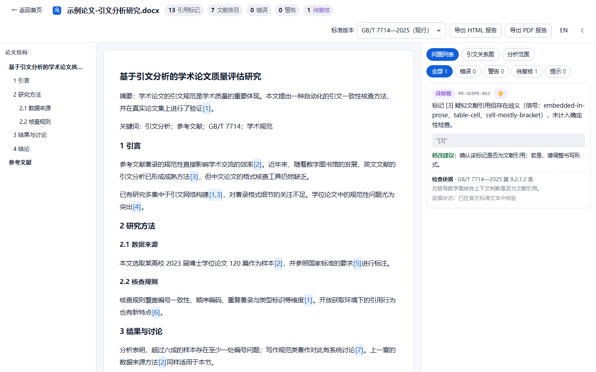
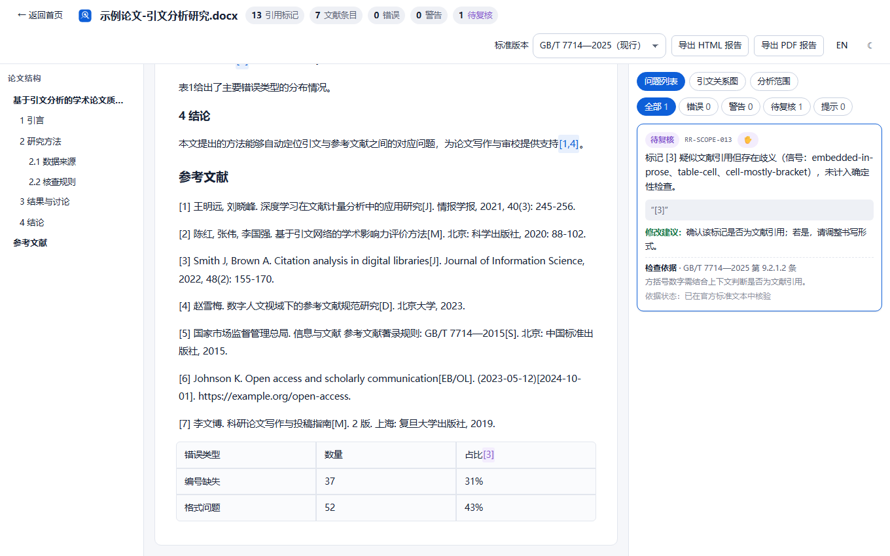
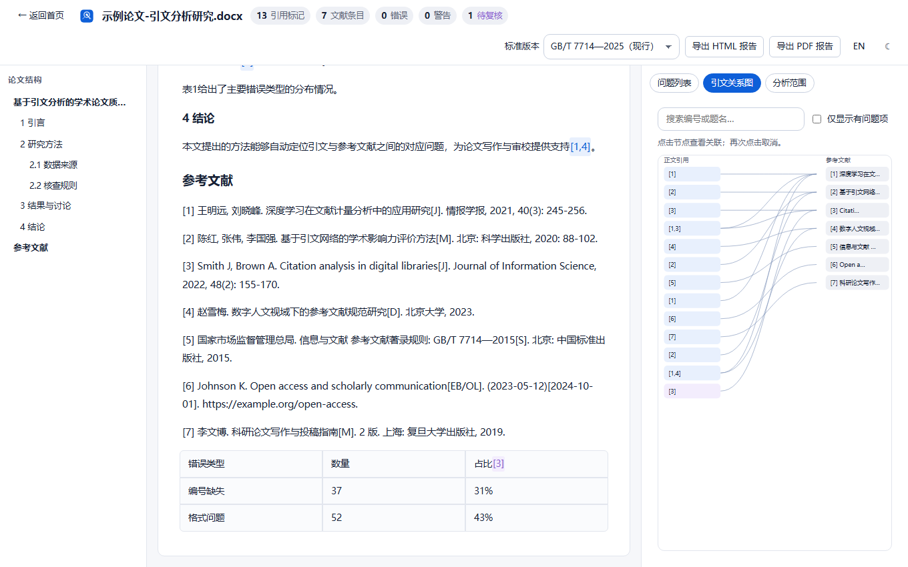
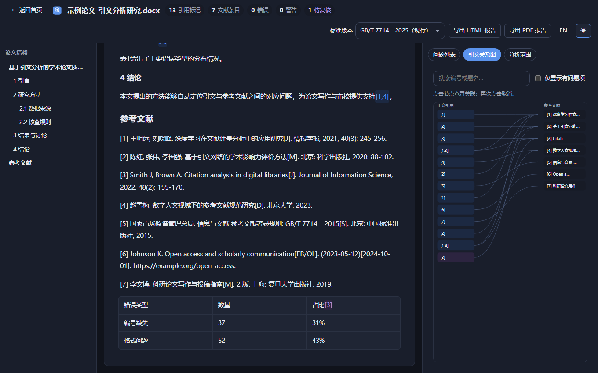

<div align="center">

# Reference Radar · 引文雷达

**Free, open-source, local-first citation & reference checker for academic papers — built around GB/T 7714 (Chinese national standard for bibliographic references).**

[Online demo](https://geyutu6755.github.io/reference-radar/) · [中文说明](README.zh-CN.md) · [Report an issue](https://github.com/geyutu6755/reference-radar/issues)

*Every finding cites its standard clause and points at the exact text.*

</div>

---



Upload a paper as **.docx** and Reference Radar — entirely in your browser, with no server, no account and no API key — finds:

- in-text numeric citations (`[1]`, `[2-4]`, `[1，3]`, full-width variants) and the reference list,
- the citation ↔ reference mapping, including **missing, duplicated and gapped numbers**,
- **first-citation ordering** problems under the sequential numbering system,
- duplicate or near-duplicate reference entries,
- document-type identifier codes that don't exist in the selected standard version,
- ambiguous bracketed numbers (math, data tables) that are deliberately **not** judged automatically.

## Online demo & offline app

The [demo site](https://geyutu6755.github.io/reference-radar/) is a full PWA: install it from the browser menu and it keeps working **offline** — analysis and report export included. Papers never leave the browser tab.

## Screenshot tour

| Home | Findings with rule basis |
|---|---|
|  |  |

| Citation graph | Dark theme |
|---|---|
|  |  |

## What it checks (and what it doesn't)

Rules are versioned per standard edition and every rule carries a source clause plus a verification status (read the matrix in [`docs/rule-coverage.md`](docs/rule-coverage.md)):

- **GB/T 7714—2025** (current, effective 2026-07-01) — 12 rules implemented; new-in-2025 type codes (`DS`, `PP`, `MM`) accepted.
- **GB/T 7714—2015** (superseded) — same structural rules with 2015 clause numbering; 2025-only codes are flagged as undefined in this edition.
- Explicitly **not** implemented in v1.0: the author–year (著者-出版年制) style, per-type field-completeness rules for all new 2025 entry types, and full-standard compliance certification. Uncited entries are reported as *info*, never as violations. See [`docs/limitations.md`](docs/limitations.md).

## Why local-first?

Your manuscript is not our data. There is no backend: the DOCX is unzipped and parsed in your browser memory, nothing is persisted, and the service worker caches only static app assets. The claims match what you can verify in the network tab — see [`docs/privacy.md`](docs/privacy.md).

## Getting started

**Use it:** open the [demo](https://geyutu6755.github.io/reference-radar/) (or run locally below), drop a `.docx`, pick a standard version, analyze. Try the built-in sample paper — it runs the real engine.

**Develop:**

```bash
git clone https://github.com/geyutu6755/reference-radar.git
cd reference-radar
pnpm install
pnpm dev            # dev server
pnpm test           # unit + golden + hostile + perf tests
pnpm exec playwright test   # E2E (Chromium/Firefox/WebKit; builds + previews automatically)
pnpm build          # production build to dist/
```

Requirements: Node 20+, pnpm 9+. All commands are verified in [`docs/testing.md`](docs/testing.md).

## Technical overview

```
DOCX bytes → safe unzip (fflate + bomb/path guards)
           → OOXML parse (preserveOrder XML, runs/fields/revisions/tables/notes)
           → DocBlock[] with char-precise anchors
           → citations + reference entries (+ confidence)
           → version-selected GB/T 7714 rule engine → Issue[]
           → workbench UI / SVG graph / HTML+PDF reports
```

- React 19 + TypeScript strict, custom CSS design system (no CSS framework), Web Worker analysis pipeline
- PDF export embeds a subset of Noto Sans CJK SC (SIL OFL) so Chinese text stays selectable
- Hand-written service worker with a build-generated precache manifest

## Contributing

Issues and pull requests are welcome — see [`CONTRIBUTING.md`](CONTRIBUTING.md). Rule additions must cite a source clause and include test cases; the meta-test runner executes every rule's declared cases.

## License

[MIT](LICENSE) — the bundled font subset is under the SIL Open Font License 1.1.
