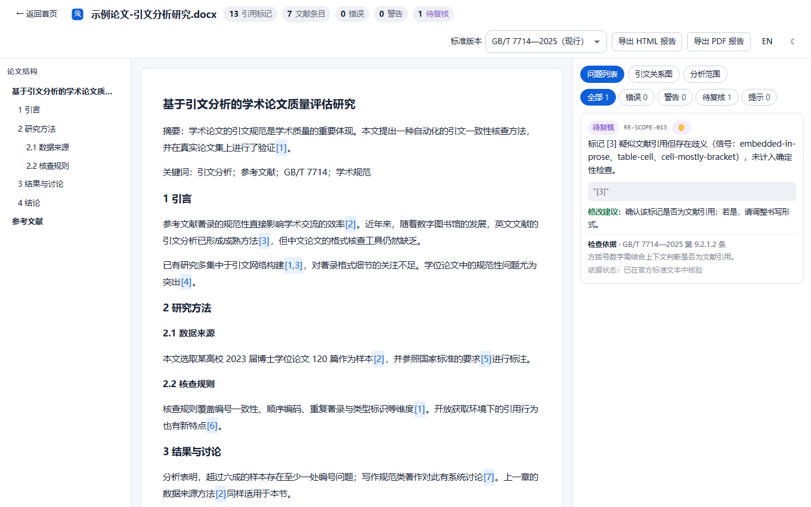
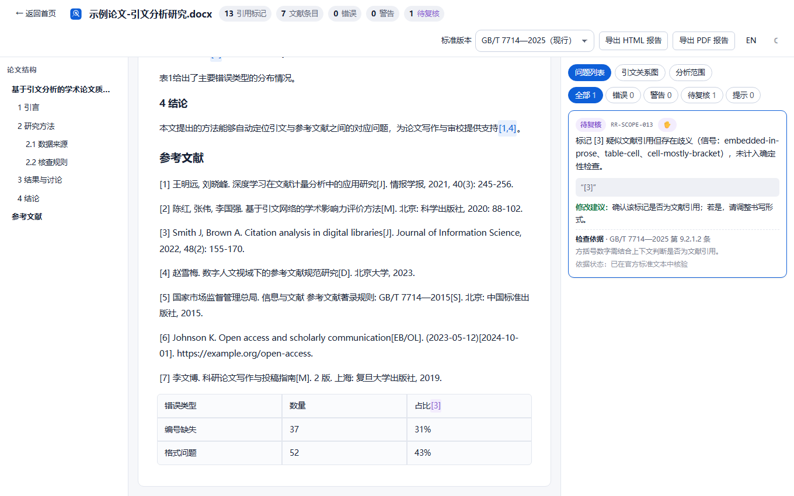
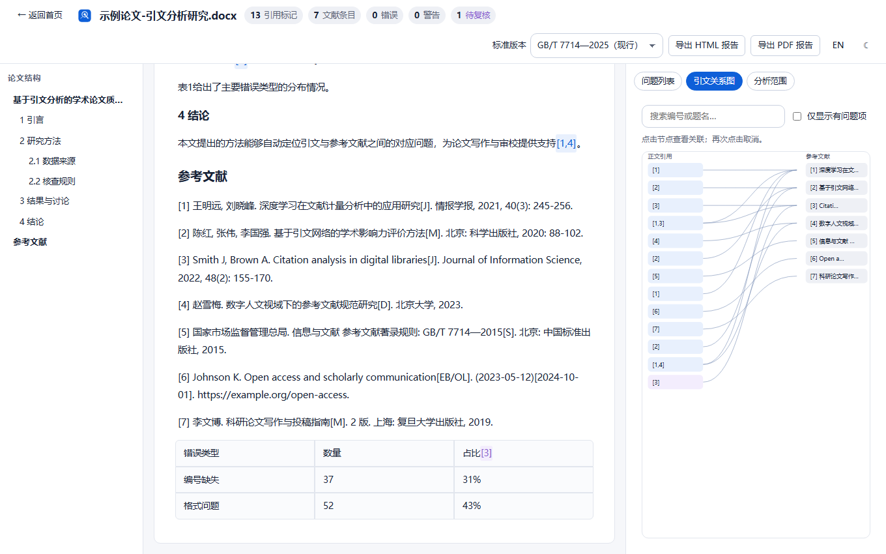
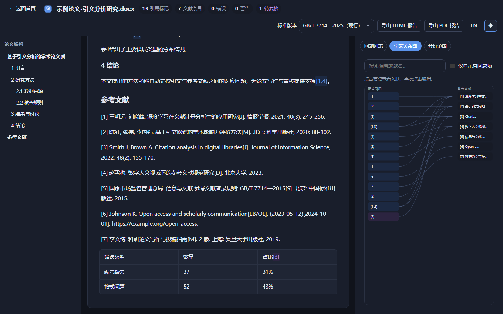

<div align="center">

# 引文雷达 · Reference Radar

**免费、开源、本地优先的学术论文引文与参考文献核查工具，围绕 GB/T 7714 国家标准构建。**

[在线演示](https://geyutu6755.github.io/reference-radar/) · [新用户教程](docs/user-guide.md) · [English](README.md) · [问题反馈](https://github.com/geyutu6755/reference-radar/issues/new/choose)

*每项判断都标注标准条款，并定位到原文。*

</div>

---



上传论文 **.docx**，引文雷达完全在浏览器本地完成解析与核查——无服务器、无账号、无 API Key：

- 识别正文中的数字型引文（`[1]`、`[2-4]`、`[1，3]`、全角变体等）与文末参考文献表；
- 建立引文与文献的对应关系，找出**缺失、重复、跳号**；
- 检查顺序编码制下的**首次引用顺序**问题；
- 发现完全重复或高度相似的著录条目；
- 检查所选标准版本中不存在的文献类型标识代码；
- 数学数组、数据表等歧义方括号**不做自动判定**，进入待复核列表。

## 在线演示与离线应用

[演示站点](https://geyutu6755.github.io/reference-radar/)是完整的 PWA：通过浏览器菜单安装后**断网也能使用**——分析与 HTML 报告导出均可用。PDF 导出在全新安装后需要先在联网状态下导出过一次，因为约 11 MB 的中文字体子集有意不预缓存（见 [`docs/limitations.md`](docs/limitations.md)）。论文不会离开浏览器标签页。

## 功能截图

| 首页 | 检查结果与依据 |
|---|---|
|  |  |

| 引文关系图 | 深色主题 |
|---|---|
|  |  |

## 检查范围（以及不检查什么）

每条规则按标准版本独立维护，均标注来源条款与核验状态（完整矩阵见 [`docs/rule-coverage.md`](docs/rule-coverage.md)）：

- **GB/T 7714—2025**（现行，2026-07-01 实施）——**19 条规则**（v1.1）：编号一致性、顺序、重复、分版本类型代码，以及基于各类型"必备性"表的著录检查（网页/数据集/预印本引用日期、URL、标准编号、学位授予单位等），并为页码连接符、日期格式等可无歧义规范化的内容提供**预览修改与一键复制**——绝不编造缺失信息。
- **GB/T 7714—2015**（已被代替）——同一批结构性规则按 2015 版条款编号；2025 独有代码在该版本下会给出未定义提示。
- **独立语料验证**：20 份**合成 DOCX 样本**（独立生成器按构造场景生成 + 人工先行标注）实测标记
  精确率/召回率 1.000、确定性错误 0 误报 0 漏报——这是构造场景上的结果，**不等于自然论文上的实测准确率**，见
  [`docs/external-validation.md`](docs/external-validation.md)。真实文档验证目前覆盖 **3 份真实文档**（两所高校模板 + 标准文本），见
  [`docs/real-docx-validation.md`](docs/real-docx-validation.md)。
- **明确不检查**：著者-出版年制、2025 新增类型中尚未覆盖类型（会议录/报告/档案/地图等）的完整必备项核查、对整个标准的合规认证。标准标为"有则必备"的元素（出版地、出版者、年卷期、页码等）不会被判为确定违规——仅凭条目文本无法区分"缺失"与"不适用"。"未被正文引用"只作为提示信息，不判定为违规。详见 [`docs/limitations.md`](docs/limitations.md) 与 [`docs/rule-coverage.md`](docs/rule-coverage.md) 的规则矩阵。

## 为什么是本地优先？

论文内容不是我们的数据。本项目没有后端：DOCX 在浏览器内存中解包解析，不做持久化，Service Worker 只缓存静态应用资源。你可以在浏览器的网络面板里直接验证这些说法——见 [`docs/privacy.md`](docs/privacy.md)。

## 快速开始

**直接使用：** 打开[演示站点](https://geyutu6755.github.io/reference-radar/)（或在本地运行），拖入 `.docx`，选择标准版本，开始分析。也可以点击"体验示例论文"——它运行的是真实引擎。

**本地开发：**

```bash
git clone https://github.com/geyutu6755/reference-radar.git
cd reference-radar
pnpm install
pnpm dev                    # 开发服务器
pnpm test                   # 单元 + 黄金样本 + 恶意输入 + 性能测试
pnpm exec playwright test   # E2E（Chromium/Firefox/WebKit，自动构建并启动预览）
pnpm build                  # 生产构建到 dist/
```

环境要求：Node 20+、pnpm 9+。所有命令的实际验证记录见 [`docs/testing.md`](docs/testing.md)。

## 技术架构

```
DOCX 字节 → 安全解包（fflate + 炸弹/路径防护）
          → OOXML 结构解析（preserveOrder；Run/域/修订/表格/脚注尾注）
          → 带字符级锚点的文档块 DocBlock[]
          → 引文与参考文献条目（含置信度）
          → 按版本选择的 GB/T 7714 规则引擎 → 问题列表
          → 工作台界面 / SVG 关系图 / HTML+PDF 报告
```

- React 19 + TypeScript 严格模式，自建设计系统（无 CSS 框架），Web Worker 分析管线
- PDF 导出内嵌 Noto Sans CJK SC 子集字体（SIL OFL），中文文本可选取
- 手写 Service Worker，预缓存清单由构建生成

## 后续路线图

计划中的版本——以下内容均未在当前版本交付；当前能力边界见
[`docs/limitations.md`](docs/limitations.md)。

- **v1.1 — 著者-出版年制。** 支持 `(Crane, 1972)` 式正文标注与"著者-出版年"文献表
  的识别解析，并按标准版本提供对应的规则集（与现有数字编码规则同样的版本化机制）。
- **v1.2 — 更广的文档覆盖。** 页眉、页脚与文本框内容分析；页下注文献表的一致性
  核查；更完整的 Zotero/Mendeley/EndNote 域元数据解析（在显示文本之外）。
- **v1.3 — 更深的著录格式规则。** 依据 GB/T 7714—2025 中经核验的著录项目表，为
  仍未覆盖的类型（会议录、报告、档案、地图等）实现必备项核查。网站网页、
  数据集、预印本（引用日期与获取路径）、学位论文（学位授予单位）、标准（标准编号）
  已在 v1.1 实现，并在 v1.1.1 修复为可从真实文档触发。
- **更远。** 将解析器与规则引擎独立发布为 npm 包；基于可核验来源扩展规则覆盖。

## 反馈与公开测试

**公开试用第 1 轮进行中**：[前往试用公告](https://github.com/geyutu6755/reference-radar/discussions/3)——本科生/研究生/编辑三类 5 分钟任务，反馈逐条公开回应。可直接发布的推广文案见 [`docs/promotion-outreach.md`](docs/promotion-outreach.md)。

欢迎用自己的论文试一试，告诉我们哪里出错：[选择模板提交
Issue](https://github.com/geyutu6755/reference-radar/issues/new/choose)——
反馈计划见 [`docs/feedback.md`](docs/feedback.md)，三分钟上手教程见
[`docs/user-guide.md`](docs/user-guide.md)。

## 参与贡献

欢迎 Issue 与 Pull Request——见 [`CONTRIBUTING.md`](CONTRIBUTING.md)。新增规则必须引用来源条款并附测试用例；元测试运行器会执行每条规则声明的全部用例。

## 开源许可证

[MIT](LICENSE)——内嵌字体子集遵循 SIL Open Font License 1.1。
